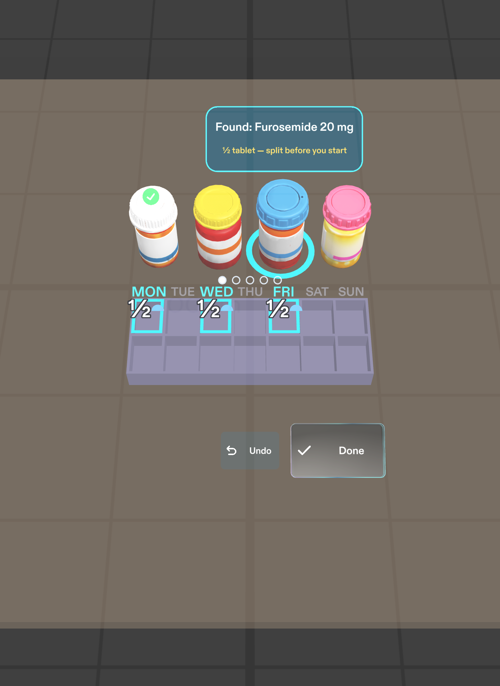
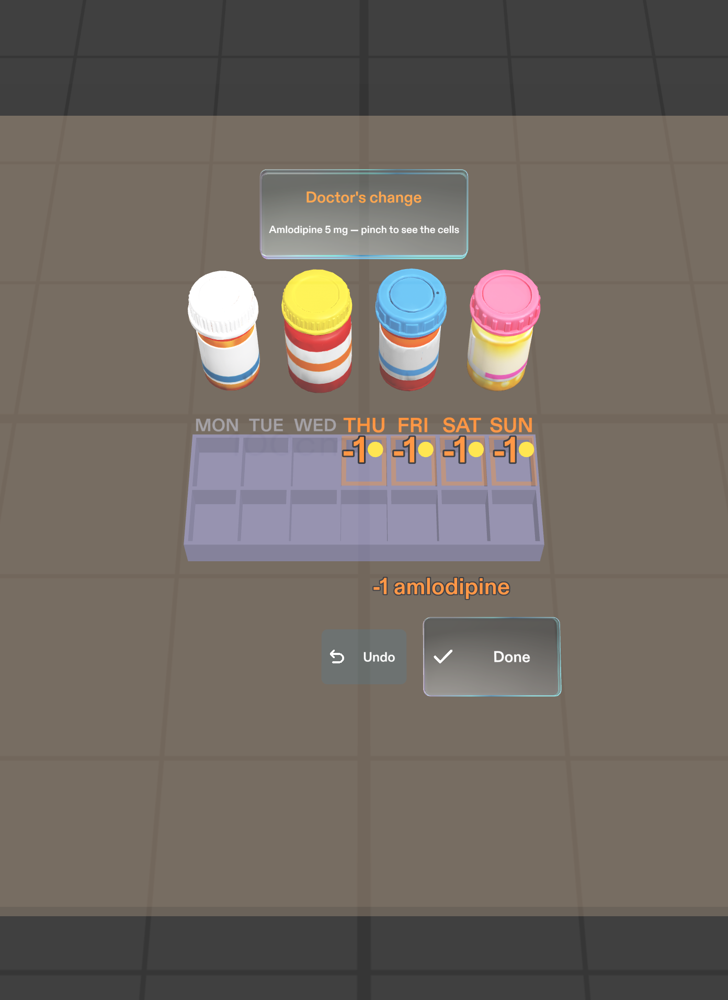

# Sunday Sort

**A Lens for SPECS glasses that lights up the right cells of a weekly pillbox as you pick up each bottle, so the person filling it never has to look away from the box.**

Sunday Sort is for the family caregiver who fills an older relative's 7-day pillbox once a week. In the US, 82% of family caregivers who take on medical tasks manage medications ([AARP, 2019](docs/evidence.md)), and sorting a week of pills is error-prone even for professionals: in one study, 60% of paid home caregivers made pillbox errors ([Northwestern, 2011](docs/evidence.md)).

The hard part isn't knowing the schedule. It's keeping your place while your hands are full: read the list, look at the box, look back at the list, drop a pill in the wrong cell. Sunday Sort puts the answer on the box itself.

## What it does

1. **Pick up a bottle.** Exactly the cells it goes into light up on the box, each with how many pills, and a card names the bottle: "Found: Metformin 500 mg". Every other cell stays dark, so the pattern shows which days differ before you read anything. A half tablet reads "½", never "0.5", with a half-pill icon and a "split before you start" note.
2. **Drop the pills in and pinch Done.** One big button in the same spot every time. The glow fades, a soft chime plays, and the bottle gets a tick. Undo clears a wrong pick.
3. **Don't forget the one in the cupboard.** When the only bottle left is the weekly vitamin D on the shelf to your left, a chime comes from that direction and a small arrow points to it. Nothing nags before then.
4. **Check before you close the lids.** Every cell shows its full contents, a total and one coloured dot per pill, so you can compare the real box at a glance. Pinch "All checked" and the box shows "Week ready".
5. **When the doctor changes a dose mid-week**, only the cells that change light up: "-1 amlodipine" on Thursday to Sunday mornings. No need to re-check the whole week.

| Half tablets | Check mode | Doctor's change |
|---|---|---|
|  |  |  |

## Why glasses

- **It shares your view.** On SPECS the camera would recognise the bottle in your hand. In this demo, pinching the bottle stands in for that moment.
- **It draws in the world.** The counts sit on the real cells at real size, not in a list on a screen.
- **It leaves your body free.** Both hands stay on the bottle and the pills, and your eyes stay on the box. A phone would need a free hand and a glance away for every bottle.

A 2019 study put a pillbox coach on a HoloLens for patients filling their own box and found older users hesitant to wear it ([details](docs/evidence.md#prior-work-and-how-sunday-sort-differs)). Sunday Sort puts the glasses on the caregiver instead.

## Try it

You need [Lens Studio](https://ar.snap.com/download) 5.23.2, the version it was built and tested in. No SPECS glasses are needed.

1. Open `Lens.esproj` in Lens Studio.
2. In the Preview panel, turn on Interactive Preview. Right-drag (or hold Shift) to look around, WASD to move, Q and E to go down and up. A click is a pinch.
3. Look down at the counter, then pinch a bottle, pinch Done, and work through the week.

The tests are LEAF scenarios in [`Assets/Tests/Leaf/`](Assets/Tests/Leaf/). Open the LEAF panel, reset the preview and run them; each prints PASSED or FAILED to the Logger. All nine pass.

## How it was built

Planned with the Devpost Learn skill pack, then built by Snap's CLAD agents in Lens Studio, driven from Claude Code through the Lens Studio MCP.

- **Plan:** the `plan-lens` interview produced the approved design brief, [`devpost/design-brief.md`](devpost/design-brief.md).
- **Build:** CLAD's `specs-experience-builder` agent built the scene and scripts, generated the bottles with AI text-to-3D through `build-mesh` and the chimes with `build-sfx`, and its `live-lens-tester` agent wrote and ran the LEAF scenarios.
- **Iterate:** two rounds of design notes reshaped the Lens, most of all a switch to designing for looking down at the counter.

The full story, with what went wrong along the way, is in [docs/how-it-was-built.md](docs/how-it-was-built.md).

## What's proven and what isn't

- **Logic proven:** every done criterion in the brief, the reach test and the layout checks pass in the preview.
- **Feel unproven:** real bottle and box recognition (stood in for by the pinch and a virtual box on a virtual counter), real hand tracking, how the chimes sound, and how the colours and text read on the additive display. Only real glasses can answer those.

## Safety

The five bottles and their schedules are **fictional sample data**, not a real prescription and not medical advice. Sunday Sort follows a list; it doesn't decide doses. On a real box, the printed prescription list stays the source of truth.

## Repo map

| Path | What's there |
|---|---|
| `Lens.esproj`, `Assets/`, `Packages/` | The Lens Studio project |
| `Assets/Scripts/SundaySort*.ts` | The Lens logic; `SundaySortData.ts` holds the sample week, `SundaySortMain.ts` runs the flow |
| `Assets/Tests/Leaf/` | LEAF test scenarios |
| `devpost/design-brief.md` | The design brief from the skill pack |
| `docs/` | Evidence, build notes and images |
| `.claude/` | The `plan-lens` skill and the CLAD plugin setting |

## License

[MIT](LICENSE)
