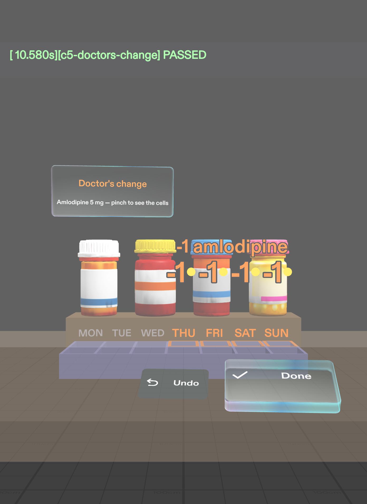
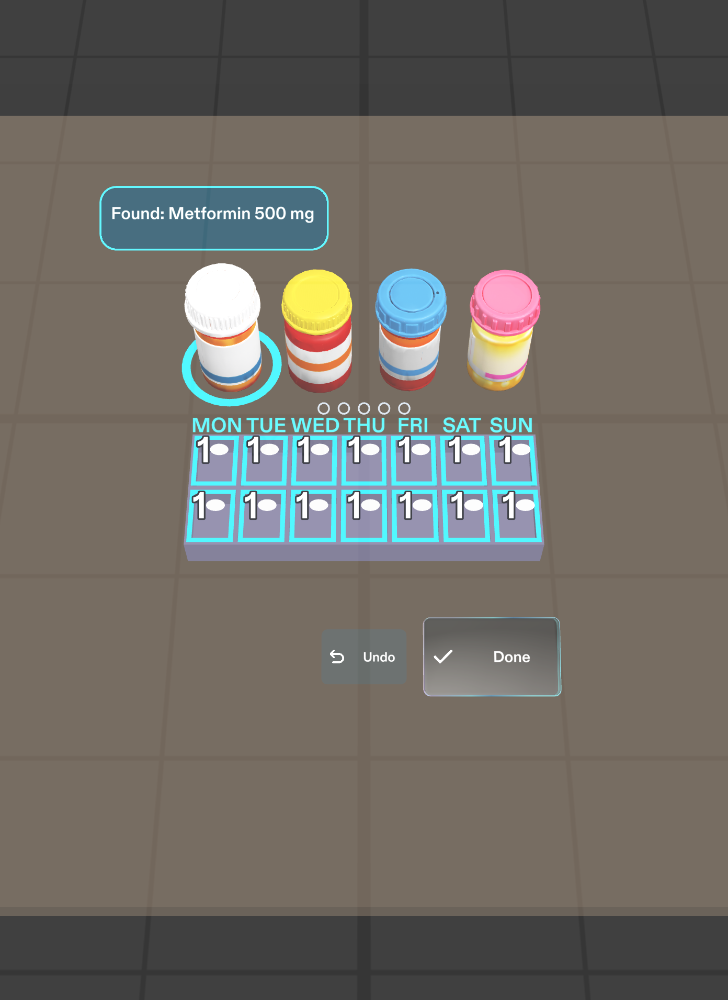
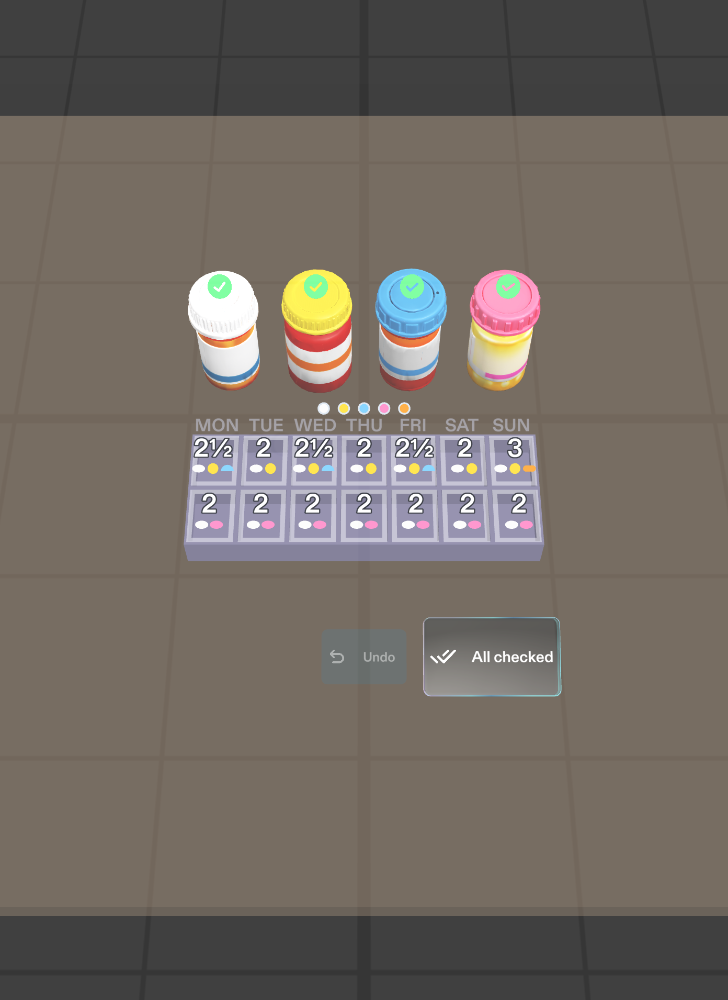

# How Sunday Sort was built

Sunday Sort was planned with the Devpost Learn skill pack and built by Snap's CLAD agents in Lens Studio, driven from Claude Code through the Lens Studio MCP. This file records the workflow and the snags we hit along the way, since most of them will hit other builders too.

## 1. Plan: the `plan-lens` interview

- Skill pack: `npx skills add challengepost/learn-specs --all -y` (one skill, `plan-lens`).
- The interview went one question at a time through the idea, the spatial moment, what the preview has to fake, where everything sits, hands, when things show, and done criteria.
- Output: [`devpost/design-brief.md`](../devpost/design-brief.md), approved with `status: approved`.

Decisions the interview pushed on, and where they landed:

| Question | Decision |
|---|---|
| How does the Lens know which bottle is in your hand? | Pinch the bottle itself. It stands in for the camera reading the label, so there is no separate "Found it" button. |
| How do you finish a bottle with pill dust on your fingers? | One 8 cm Done button in a fixed spot. The 3 cm cells are display only, never targets. |
| What if the last bottle is out of view? | A chime from its direction and a small arrow, only once everything else is done. |
| Is the mid-week dose change in scope? | Yes, but built last and marked stretch, after fill and check pass their tests. |

## 2. Build: CLAD through the Lens Studio MCP

- CLAD plugin: `ls-clad@ls-extensions`, enabled for this project in [`.claude/settings.json`](../.claude/settings.json).
- Prompt, in a fresh session: *"Read devpost/design-brief.md and build it for SPECS. Follow the brief closely. Get the basic flow working first, then add detail. Write and run LEAF tests for each done criterion, and tell me which pass."*
- CLAD's `lens-studio-router` checked the project, the MCP connection and the sign-in, then handed off to the `specs-experience-builder` agent.
- Assets: five pill bottles from AI text-to-3D through `build-mesh`, three chimes from `build-sfx` (done, nudge, week ready), and Material icons for the buttons.
- Logic: TypeScript components in `Assets/Scripts/SundaySort*.ts` (twelve in the first build, thirteen after the doctor's change). `SundaySortData.ts` holds the sample week; `SundaySortMain.ts` runs the flow.
- After building, the agent pinched through the flow itself in the preview, then handed testing to CLAD's `live-lens-tester` agent.

### First build: LEAF results

The LEAF scenarios live in [`Assets/Tests/Leaf/`](../Assets/Tests/Leaf/). Each one drives the Lens with simulated pinches in Lens Studio's preview.

| # | Done criterion | Result |
|---|---|---|
| 1 | Pinching metformin lights exactly its 14 cells with "1" and shows its card | Pass |
| 2 | Done fades the glow, chimes, fills the dot and ticks the bottle; Undo clears the selection | Pass |
| 3 | Furosemide lights only Monday, Wednesday and Friday mornings with "½", and those day labels brighten | Pass |
| 4 | With only the vitamin D left and out of view, a chime from the left and an arrow; then check mode and "Week ready" | Pass |
| 5 | Doctor's change (stretch) | Not built yet |

What the tests can't prove, so it's labelled **feel unproven** until the Lens runs on SPECS:

- Sound: the tests confirm the chimes play and that the nudge comes from the left, not how they sound.
- Head turns: simulated. The test pauses device tracking while it turns the view, otherwise the preview resets the pose every frame.
- Readability: colours and text are checked as values, not as they look on the additive display.

An extra reach test (`IKReachScenario`) found a real problem: when a simulated arm aims at the furosemide bottle, the metformin bottle behind it catches the aim. Criterion 3 still passes because LEAF's pinch goes straight to the bottle, but on glasses the wrong bottle could be picked.

Two tool notes from the build:

- Pinching a UI Kit button by name in the preview tool can fail as "obstructed by Collider" (the button's own child collider). Pinching at the button's world position works; LEAF's hand pinch is unaffected.
- LEAF scenarios that turn the head need the camera's device tracking paused, or the preview resets the turn every frame.

### Fixing with design notes, not code

The brief's last section says to judge the build in the preview and send fixes as design notes. Two rounds of notes changed the Lens more than the first build did.

**Round 2: fit the portrait view, add the doctor's change.** The SPECS preview is portrait, about 33 cm wide at 60 cm, so the box plus a 2x2 group of bottles beside it didn't fit. The notes moved the bottles into one row behind the box, which also cleared the aim problem the reach test found, moved Done and Undo off the cells, and asked for criterion 5.

**Round 3: design for looking down.** Round 2 worked but didn't read. With the box near eye level, the cells were seen almost edge-on, and the counts had to float 4 to 7 cm up to stay visible, so they drew across the bottles:

At home you look down at the counter while you sort pills, and SPECS' own guidance says to design around where people already look, often down at their hands or the table. So the counter went to kitchen height, about 90 cm, with the box about 40 cm ahead and below the eyes. From there the 14 cells read as a grid, each count sits inside its own cell, and a small "Look down at your pillbox" hint covers the moment the Lens starts with the box out of view.

| Round 3: metformin | Round 3: check mode |
|---|---|
|  |  |

### Final LEAF results

All nine scenarios pass in the preview, each one starting with the head pitched down to the box.

| Scenario | Checks | Result |
|---|---|---|
| Look-down hint | Shows at the bottom of the view with a down arrow, hides once the box is in view | Pass |
| 1. Metformin | Exactly 14 cells with "1"; each count stays inside its cell; nothing covers a cell or a bottle | Pass |
| 2. Done | Glow fades, chime plays once, the bottle's dot fills and it gets a tick | Pass |
| 2. Undo | Selection cleared, nothing marked done | Pass |
| 3. Furosemide | Only MON, WED, FRI mornings, each "½" with a half-pill icon; those day labels brighten | Pass |
| 4. Vitamin D, check, week ready | One chime from the left and an arrow; then every cell's total and pills; "Week ready" | Pass |
| 5. Doctor's change, then Done | Only THU to SUN mornings pulse orange with "-1"; Done applies it | Pass |
| 5. Doctor's change, then Undo | Nothing applied; the card can be reopened | Pass |
| Reach | A full simulated arm aims at each bottle, Done, Undo and the vitamin D; every aim lands on its own target | Pass |

The layout checks in `SundaySortLayoutChecks.ts` measure on-screen overlap from the looking-down pose, so "nothing covers anything" is tested, not eyeballed. They hold from about 48° to 64° of look-down; past about 66° the bottle cards leave the top of the view.

## 3. Snags worth knowing about

**Lens Studio 5.24 deletes the skill pack.** Its Agents-Docs plugin removes `.agents/` on every project load as a "legacy cleanup" (`[AgentsDocs] Removed legacy .agents/ directory` in the log). The skills installer puts `plan-lens` in `.agents/skills/` and only symlinks it from `.claude/skills/`, so the skill vanished the first time the project opened. Fix: keep the skill as real files in `.claude/skills/plan-lens`.

**Signing in on 5.24.1 failed, which blocks CLAD.** Lens Studio 5.24.1 signs in through the new Specs account page, which kept answering "Something went wrong". CLAD's router has a mandatory sign-in gate, so the build stopped with `not_signed_in`. The organizers' published fix worked: on Lens Studio **5.23.2** sign-in went through first time. Recreate the Base Template there rather than opening a 5.24.1 project in it: the older editor warns the project and its Spectacles packages come from a newer version.

**Claude Code can remember "no" for the MCP server.** If the prompt to use the project's `.mcp.json` server is dismissed, the `lens-studio` server silently disappears from `/mcp`. `claude mcp reset-project-choices`, then restart and choose "Use this and all future MCP servers in this project".

**The faint "100cm" in some screenshots isn't the Lens.** Behind unlit cells you may see a faint "100cm". It's the distance marker on the floor of Lens Studio's built-in Plane preview scene. The SPECS preview blends the Lens over that room the way the additive display would, so the floor shows through the virtual counter. CLAD confirmed no text in the Lens matches, and the marker slides with the floor when the viewpoint moves. It can't appear on real glasses.

**Lens Studio adds Git LFS rules.** It writes a `.gitattributes` that routes everything in `Assets/` and `Packages/` through Git LFS. This repo leaves that file untracked and stores assets as ordinary files, so they stay readable on GitHub.

## 4. Tools

| Tool | Version |
|---|---|
| Lens Studio | 5.23.2 |
| Spectacles Interaction Kit, Spectacles UI Kit | as shipped with the 5.23.2 SPECS Base Template |
| Claude Code | 2.1 |
| CLAD (`ls-clad`) | 1.0.0 |
| Skill pack | `challengepost/learn-specs` (`plan-lens`) |
